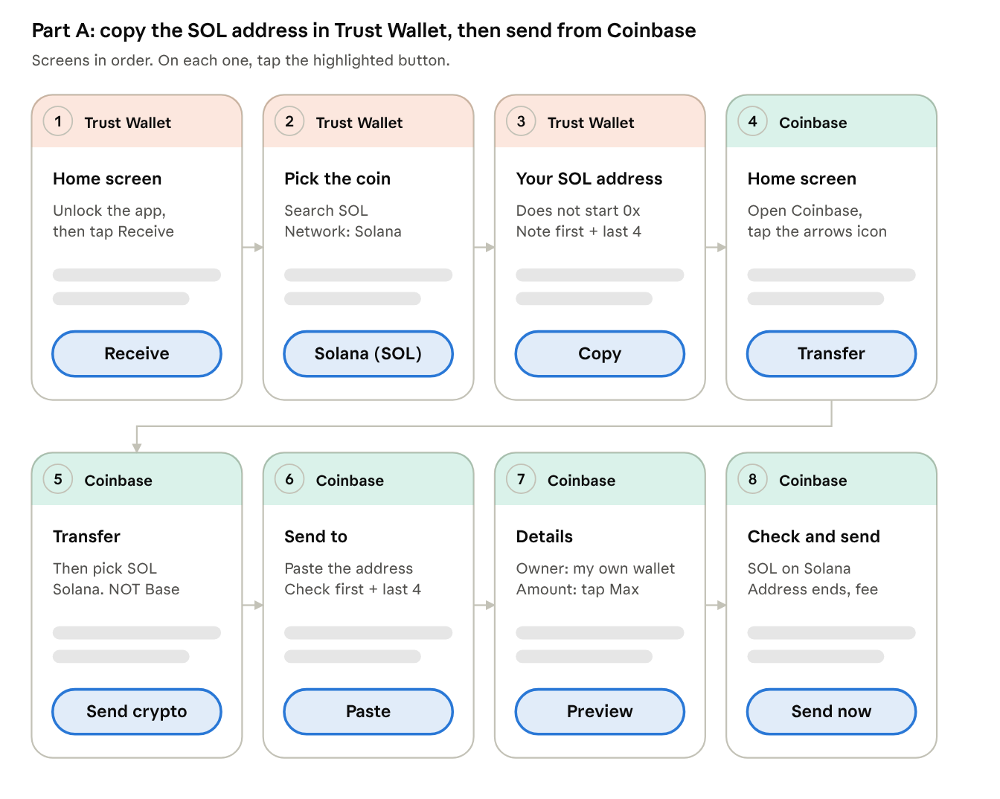
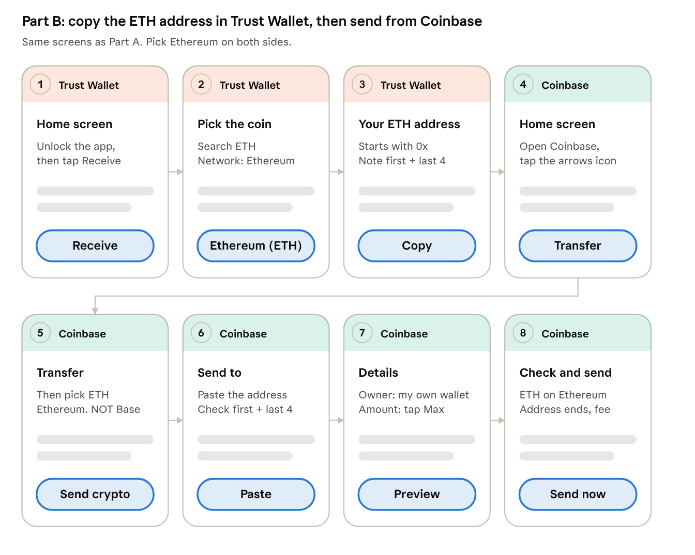

# Purchase with USDT using Coinbase and Trust Wallet

A step-by-step guide, written for November 2026 versions of the Coinbase and Trust Wallet apps.

> [!CAUTION]
> **This guide is not financial, legal or tax advice. It is a how-to for people who have already decided, with their eyes open, to make these transfers.**

**New to this?** Start with the [simple picture guide](guide.md): one idea per page, with pictures. Then come back here for the full details. This README is the definitive version.

## READ THIS FIRST: the risks

**Stop and read all of this before you touch any app.** This guide shows you *how* to make the transfers. It does not make them safe, and nothing can make them reversible. If any point below makes you uneasy, that unease is the correct reaction. Close the apps and walk away.

**Crypto itself**

- **You can lose all of it.** Crypto is high-risk and largely unregulated. Treat all the Sterling (or local currency) you put in as money you can afford to lose completely.
- **No safety net.** Crypto is not a bank deposit. The Financial Services Compensation Scheme (FSCS) does not cover it, and the Financial Ombudsman Service generally can't help you get crypto back.
- **Every send is final.** There is no "undo", no chargeback and no fraud team that can reverse a blockchain transaction. A wrong address, a wrong network or a scammer's address means the money is gone. Permanently.
- **Prices swing hard.** SOL and ETH can move by several per cent in an hour. The amounts in this guide will not match your screen to the penny, and that's normal.
- **Stablecoins are not cash.** USDT aims to stay at $1, but it is a private company's token, not money in a bank. It has briefly dropped below $1 before, and its issuer can freeze USDT held at any address.

**Paying someone you can't see**

- **You probably can't verify who they are.** A website, a company name, a friendly voice or a WhatsApp profile proves nothing. Scammers build all of these in minutes.
- **"Pay me in USDT" is a classic scam request.** Fake investments, fake jobs, romance scams, fake HMRC or bank officials, fake tech support, and "recovery" services that promise to get back money you've already lost all ask for USDT, precisely because it can't be clawed back.
- **No buyer protection.** If you pay for goods or services in crypto and they never arrive, there is usually no one to complain to and no refund route. Bank-transfer fraud refunds generally don't cover crypto you send yourself from your own wallet.
- **Pressure is the tell.** Urgency ("today only", "or your account will be closed"), secrecy ("don't tell your bank") or being coached through the steps by someone else are red flags. Stop.
- **Address poisoning and clipboard attacks.** Scammers send tiny amounts from look-alike addresses so a fake one appears in your history, and malware can swap a copied address for theirs. That's why this guide makes you check the first 4 and last 4 characters every single time.

**Holding it yourself (Trust Wallet)**

- **You are the bank.** Lose your 12-word Secret Phrase, or let anyone see it, and the wallet and everything in it are gone. No one can reset it for you.
- **Fake apps and fake support exist.** Only install Coinbase and Trust Wallet from the official app store. Real support never DMs you first and never asks for your phrase.

**Tax and rules**

- **Spending or swapping crypto can be a taxable event.** In the UK, disposing of crypto (selling, swapping or spending it) can create a Capital Gains Tax liability. Keep a record of every transaction.
- **Your bank or Coinbase may pause or question transfers.** That's their fraud and anti-money-laundering checks doing their job. Don't try to get around them.

## Assumptions

This guide only works if **all** of these are true. If any one isn't, stop and sort it out first, or this guide isn't for you.

**Your accounts and apps**

1. **You have a Coinbase account, verified and funded.** Your identity checks are done, there is Sterling (or local currency) in your cash balance, and it has cleared, not still on hold.
2. **You already have Trust Wallet set up.** The wallet is created, and its 12-word Secret Phrase is written on paper and stored safely offline. You have checked you can open the wallet.
3. **2-step verification works on Coinbase**, and you can approve sends with it right now.
4. **Both apps came from the official app store** (Apple App Store or Google Play), are up to date, and are on a phone that is yours and up to date.

**You and where you are**

5. **You're in the UK, or a country where Coinbase lets you buy and send SOL, ETH and USDT.** What Coinbase offers varies by country. In some countries USDT isn't available at all. Check your app before you start.
6. **You are an adult, acting for yourself, with your own money and accounts.** No one else is logged in, telling you what to tap, or watching your screen.
7. **You're in a private, unhurried setting.** You're on your own phone and a trusted connection (home Wi-Fi or mobile data, not public Wi-Fi). Screen-sharing and remote-access apps are closed. You've set aside at least an hour, more if Coinbase holds a send for review.

**The money and the recipient**

8. **You already know who you're paying and why, and you've decided to pay in USDT.** This guide shows how to send. It does not check that the recipient is genuine. That's on you (see the risks above).
9. **The recipient accepts USDT on Ethereum or Solana**, and will give you their address in writing. Tron and Base are not covered.
10. **You can afford the extra.** On top of the payment, you need about 10 Sterling (or local currency equivalent) for the SOL and ETH practice and fee money, plus a few dollars of network fees. Top-ups may cost more.
11. **You're comfortable with copy and paste on your phone**, and with switching between two apps.
12. **Your apps look roughly like they did in November 2026.** If a button has moved or been renamed, pick the closest match. If something looks very different, stop and check.

## Before you start

You will make **three journeys (transactions), one coin at a time, made up of six sends in total.** Each send is followed by a pause to confirm it landed:

1. **Transaction 1 of 3: about $5 of SOL** from Coinbase to Trust Wallet (Part A). This is your first test.
2. **Transaction 2 of 3: about $5 of ETH** from Coinbase to Trust Wallet (Part B). This is your second test.
3. **Transaction 3 of 3: USDT** to your recipient (Part C). This is the real one. It moves in stages, each with a ~$5 test first: a test to your own Trust Wallet, then the rest; then a test to the recipient, then the rest.

| Send | What | From → To | Journey |
| --- | --- | --- | --- |
| 1 of 6 | SOL | Coinbase → Trust Wallet | Transaction 1 |
| 2 of 6 | ETH | Coinbase → Trust Wallet | Transaction 2 |
| 3 of 6 | USDT, ~$5 test | Coinbase → Trust Wallet | Transaction 3 |
| 4 of 6 | USDT, the rest | Coinbase → Trust Wallet | Transaction 3 |
| 5 of 6 | USDT, ~$5 test | Trust Wallet → recipient | Transaction 3 |
| 6 of 6 | USDT, the rest (the Full Monty) | Trust Wallet → recipient | Transaction 3 |

That's **four sends in** (Coinbase to your Trust Wallet) and **two sends out** (Trust Wallet to the recipient). Buying coins in Coinbase isn't a send, so the three purchases aren't counted. A fee top-up, if you need one, adds one extra inbound send each time.

The SOL and ETH aren't just practice: they become the fee money ("gas") that Transaction 3 needs. Every address is copied from Trust Wallet's own Receive screen (or, for Transaction 3, from the recipient) and pasted, never typed. Button names below match the apps as of November 2026. If a label differs slightly after an update, pick the closest match.

**Have ready**

- [ ] Coinbase app updated, you are logged in, and your 2-step verification (code or passkey) works.
- [ ] Some Sterling (or local currency) in your Coinbase cash balance. Step 0 below turns about 10 Sterling (or local currency equivalent) of it into SOL and ETH for Transactions 1 and 2. The USDT for Transaction 3 comes later.
- [ ] Trust Wallet app updated, a wallet created, and its 12-word Secret Phrase written on paper and stored offline.
- [ ] Solana and Ethereum visible on the Trust Wallet home screen. If either is missing, use the search or Manage crypto option on the home screen to switch it on.

**Seven rules that make this bulletproof**

1. **Copy, never type.** For your own wallet, take each address from Trust Wallet's Receive screen with the Copy button. Never use an address that someone sends you claiming it is yours. The only address you ever accept from another person is the recipient's, in Transaction 3, and it gets extra checks in Part C before anything is sent.
2. **Match the network.** SOL goes on the **Solana** network. ETH goes on the **Ethereum** network. USDT goes on the network your recipient names, and **never Base**. A wrong network can lose the funds.
3. **Check the ends.** After pasting into Coinbase, compare the first 4 and last 4 characters with Trust Wallet. If any differ, stop: your clipboard may have been tampered with.
4. **Never share your 12-word phrase.** Coinbase, Trust Wallet and their support staff never ask for it. If someone else told you to make this transfer, stop and talk to someone you trust first.
5. **Sends cannot be reversed.** That is why the three transactions go in order, smallest and safest first, with a big pause after each one.
6. **Never pay a vendor from an exchange.** Coinbase is only for buying coins and moving them to *your own* Trust Wallet. Every payment to anyone else goes from Trust Wallet, your private wallet. Never paste a recipient's address into Coinbase.
7. **Test first, then the Full Monty.** Before committing any larger amount, send a test of about $5. Wait until you have *seen* it arrive (in your own wallet) or the recipient has *confirmed* it in writing. Only then send the rest.

**Why not use Trust Wallet's "Deposit from exchange" button?**

Trust Wallet's Receive screen has a Deposit from exchange option. You pick Coinbase, log in to your Coinbase account from inside Trust Wallet, and it fills in the details for you. It is a real feature and avoids copy-paste mistakes. This guide does it by hand on purpose [1]:

- **You see and check every detail yourself.** Address, network and fee are all on screen in Coinbase before you tap Send now. That check is the skill you need for Transaction 3 (USDT).
- **Your Coinbase login stays in the Coinbase app.** A good habit to keep: fake "connect your exchange" screens are a common way people lose their accounts.
- **One app is in charge of the send.** If something goes wrong, Coinbase support can see the whole send. With two linked apps, each support team can point at the other.

> [!CAUTION]
> **This guide is not financial, legal or tax advice. It is a how-to for people who have already decided, with their eyes open, to make these transfers.**

## Step 0: Buy the SOL and ETH with your Sterling (or local currency) balance

This gets the coins for Transactions 1 and 2. You'll buy the USDT later, at the start of Transaction 3.

**Buy 5 Sterling (or local currency equivalent) of SOL, and the same of ETH.** After Coinbase's buying fee, that gets you roughly $5 worth of each coin. Prices move all the time, so expect it to wobble by a few cents. The network fee for each send comes out of that, so slightly under $5 of each lands in Trust Wallet.

**Buy SOL**

1. Open **Coinbase**. On the Home tab, tap **Buy** (the **+** button).
2. Search **Solana** and tap **Solana (SOL)**. Check it says SOL, not a similarly named token.
3. Type **5** in Sterling (or local currency).
4. Check **Pay with** shows your **GBP (or local currency) balance**. If it shows a card or bank, tap it and switch to GBP (or local currency) balance.
5. Tap **Preview buy**. The screen shows the SOL you get and the Coinbase fee.
6. Tap **Buy now**. Wait for the confirmation, then tap **Done**.

**Buy ETH**

7. Tap **Buy** again, search **Ethereum**, tap **Ethereum (ETH)**.
8. Type **5** in Sterling (or local currency), check **Pay with: GBP (or local currency) balance**, tap **Preview buy**, then **Buy now**.

**Check before moving on**

- [ ] Home or Assets shows **SOL** and **ETH**, each worth about 5 Sterling (or local currency equivalent).
- [ ] Your cash balance has dropped by about 10 Sterling (or local currency equivalent).

If Coinbase says the crypto cannot be sent yet, the Sterling (or local currency) was probably deposited recently and is on a short hold. The app shows when it becomes available.

## Part A — Transaction 1 of 3 (send 1 of 6): Send $5 of SOL

Get your Solana address from Trust Wallet first, then send to it from Coinbase. The picture after the steps shows each screen in order. [2] [3]

**In Trust Wallet: copy your Solana address**

1. Open **Trust Wallet** and unlock it.
2. On the home screen, tap **Receive**.
3. In the search box, type **SOL** and tap **Solana (SOL)**. The network shown must say **Solana**.
4. You now see a QR code and a long address of letters and numbers. It does **not** start with 0x.
5. Tap **Copy**. Write the first 4 and last 4 characters on paper.

**In Coinbase: send the SOL**

6. Open the **Coinbase** app and sign in.
7. Tap **Transfer** (the two-arrows icon), then **Send crypto**.
8. Choose **Solana (SOL)** as the asset.
9. When asked for the network, choose **Solana**. **NOT Base.** Not anything else.
10. Tap the address field and **paste**. Check the first 4 and last 4 characters against your paper note.
11. If Coinbase asks who owns the wallet, say it is **your own self-custody wallet** and name it **Trust Wallet**. UK rules require this question.
12. On the amount screen, **tap Max** to send all the SOL you bought in Step 0. Coinbase takes the network fee out of it, so nothing is left stranded.
13. Tap **Preview**. Check four things: asset **SOL**, network **Solana**, the address ends, and the network fee.
14. Tap **Send now** and complete the 2-step verification.
15. Coinbase shows a confirmation. Tap **Done**.

Simplified screen layouts, not exact copies of the apps. Three screens in Trust Wallet to copy the address, then five in Coinbase to send.

## BIG PAUSE after Transaction 1: stop here until the SOL has arrived

**Do not start Part B (Transaction 2) yet.** The SOL send is your first test. Only move on when every box below is ticked.

- [ ] In Coinbase, **Transactions** (or the SOL asset page) shows the send as **Sent** or **Completed**, not Pending.
- [ ] In Trust Wallet, tap **Solana** on the home screen. A new incoming amount of about $5, less the fee, is listed.
- [ ] The amount in Trust Wallet looks right.

Most Solana sends arrive within a few minutes. Coinbase sometimes holds a first send to a new address for a security check. Give it up to an hour before you worry, then use Troubleshooting below.

**Why pause?** If the SOL arrived, you have proved the whole routine works: the apps, the copy-paste, the network choice and the address check. Part B is the same routine with ETH.

> [!CAUTION]
> **This guide is not financial, legal or tax advice. It is a how-to for people who have already decided, with their eyes open, to make these transfers.**

## Part B — Transaction 2 of 3 (send 2 of 6): Send $5 of ETH

Same routine as Part A, with two differences: you pick **Ethereum** as the network, and the address starts with **0x**.

**In Trust Wallet: copy your Ethereum address**

1. Open **Trust Wallet** and tap **Receive**.
2. Search **ETH** and tap **Ethereum (ETH)** on the **Ethereum** network. Do not pick ETH on Base, Arbitrum, BNB Smart Chain or any other network.
3. Check the address starts with **0x** and is 42 characters long.
4. Tap **Copy**. Write the first 4 characters after 0x and the last 4 on paper.

**In Coinbase: send the ETH**

5. Open **Coinbase**, tap **Transfer**, then **Send crypto**.
6. Choose **Ethereum (ETH)**.
7. When asked for the network, choose **Ethereum**. **NOT Base**, even if Coinbase shows it as free.
8. Paste the address. Check the ends against your paper note.
9. Answer the wallet-owner question as before: your own self-custody wallet, **Trust Wallet**.
10. On the amount screen, **tap Max** to send all the ETH you bought in Step 0.
11. Tap **Preview**. Check asset **ETH**, network **Ethereum**, the address ends, and the fee.
12. **Fee check:** on Ethereum the fee can be a noticeable share of $5. If it looks too high, cancel and try at a quieter time, such as early morning UK time.
13. Tap **Send now**, complete 2-step verification, then **Done**.
14. In Trust Wallet, tap **Ethereum**. The ETH usually shows within a few minutes.

The same eight screens as Part A. The only changes are the coin (ETH), the network (Ethereum) and an address starting with 0x.

**Do NOT pick Base.** Coinbase may offer Base as a free or cheaper network. Ignore it [4]. Base is a separate network: your ETH would land in Trust Wallet on its own "ETH on Base" line and look missing. If it happens anyway, see **Landed on Base by mistake?** in Part C.

## BIG PAUSE after Transaction 2: stop here until the ETH has arrived

**Do not start Part C (Transaction 3) yet.** Only move on when every box below is ticked.

- [ ] In Coinbase, the ETH send shows as **Sent** or **Completed**, not Pending.
- [ ] In Trust Wallet, tap **Ethereum** (the Ethereum line, **not** "ETH on Base"). The incoming ETH is listed.
- [ ] Trust Wallet now holds **both** your SOL and your ETH. That's your fee money for Transaction 3.

**Why pause again?** Transaction 3 is the one with real money in it. You want two clean, confirmed practice runs behind you, and fee money sitting ready, before you start it.

> [!CAUTION]
> **This guide is not financial, legal or tax advice. It is a how-to for people who have already decided, with their eyes open, to make these transfers.**

## Part C — Transaction 3 of 3 (sends 3 to 6): The real one, USDT to your recipient

**TL;DR:** Get the recipient's network and address. Check they match. Buy USDT. Move a ~$5 test to Trust Wallet on that network (**NOT Base**), watch it arrive, then move the rest. Send the recipient a ~$5 test **from Trust Wallet**. They confirm. Send the rest.

> [!IMPORTANT]
> **Never pay the recipient straight from Coinbase. Always pay from Trust Wallet, your private wallet.**

**Why pay from Trust Wallet and never from Coinbase?**

- **Coinbase is the shop, not your purse.** Coins sitting in Coinbase are held by Coinbase. It can pause, question or block a payment to someone else as part of its fraud and anti-money-laundering checks, sometimes after the money has already left your balance.
- **Your account is at risk.** Paying third parties from an exchange can get your account reviewed, restricted or closed, especially if the recipient later turns out to be connected to a scam.
- **Refunds can go missing.** Exchanges often send from shared addresses that aren't yours. If the recipient sends anything back "to where it came from", it may never reach you.
- **Fewer details shared.** Coinbase asks who you're sending to. Paying from your own wallet keeps your exchange account and the person you're paying apart.
- **You stay in control.** In Trust Wallet only you hold the keys, and you decide exactly what goes, where and when.

This is the money that matters, so slow is fast here. Transactions 1 and 2 were the rehearsal. Your SOL or ETH now pays the fee when you send USDT out of Trust Wallet.

### Your fee money (aka "gas")

**When anyone says "gas", "gas fee" or "network fee", they mean your ETH or your SOL.** It's the network's own coin, used to pay for each send:

- USDT on **Ethereum** → gas is paid in **ETH**.
- USDT on **Solana** → gas is paid in **SOL**.
- USDT on **Tron** → gas is paid in **TRX**, which this guide doesn't cover.

You can't pay gas in USDT. Zero ETH or SOL means your USDT is stuck until you top up. Sends *from Coinbase* are different: Coinbase takes its fee out of what you send, so gas only matters for sends *from Trust Wallet*.

**How long does $5 last?** Each send from Trust Wallet costs one fee. Transaction 3 needs at least two of them: sends 5 and 6, the test and the rest.

| Fee coin | Typical fee per USDT send | Roughly how many sends $5 covers |
| --- | --- | --- |
| SOL (Solana) | Under $0.10, usually a fraction of a cent | Dozens or more |
| ETH (Ethereum) | About $1–10, depending on how busy the network is | 1 to 4 when busy, more when quiet |

Notes:

- On Solana, the first send to someone who has never held USDT costs a bit more, because it opens a USDT account for them. Still pennies.
- On Ethereum the fee swings a lot. Trust Wallet shows the exact fee before you confirm. If it looks silly, cancel and try later. Early morning UK time is often quieter.
- A tiny amount of SOL always stays behind in a Solana wallet. That's normal.

**Topping up your fee money**

If Trust Wallet says *insufficient balance for fee* or similar:

1. In Coinbase, buy about **5 Sterling (or local currency equivalent) of ETH or SOL**, whichever you're short of. Same steps as **Step 0**.
2. Send it to Trust Wallet exactly as in **Part A** (SOL) or **Part B** (ETH). Tap **Max**, **NOT Base**.
3. Wait until it shows in Trust Wallet, then go back to where you stopped.

Fee estimates: notes [5] and [6].

### 1. Ask the recipient two things, in writing

- **"Which network do you want the USDT on?"**
- **"What is your USDT address on that network?"** Ask them to paste it as text, not send a screenshot.

### 2. Work out the network from the address

USDT runs on several networks. Each address type looks different:

| Address starts with | Length | Network | Fee coin from Trust Wallet | Can Coinbase send USDT on it? |
| --- | --- | --- | --- | --- |
| **T** | 34 characters | Tron (TRC-20) | TRX (you don't have any) | Usually not. Check the app's network list |
| **0x** | 42 characters | Ethereum (ERC-20), but BNB Chain, Polygon, Arbitrum and Base use the same format | ETH | Yes on Ethereum |
| Anything else, no 0x | 32–44 characters | Solana | SOL | Check the app's network list |

A Solana address can also start with T, so length is the tiebreaker: T plus exactly 34 characters is almost certainly Tron.

### 3. The extra check: does what they say match the address?

- They say **Tron / TRC-20** → the address must start with T and be 34 characters.
- They say **Ethereum / ERC-20** → it must start with 0x and be 42 characters.
- They say **Solana** → no 0x, 32–44 characters.
- **They send a 0x address but name no network** → ask. A 0x address works on many networks, so the address alone can't tell you which one.

**If it doesn't match, don't send.** Tell them what you see ("you said Tron, but this starts with 0x") and ask them to resend both. Still doesn't match, or they get vague, pushy, or go "just send it, it'll be fine"? Walk away. A real person or business knows which network it uses.

### 4. The one rule for Coinbase: never select Base

Coinbase often puts **Base** first or labels it free. **For this whole transfer, never select Base.** Check the network every single time a picker appears. [4] Base is right only if the recipient explicitly asked for Base, and this guide doesn't cover that.

### 5. Do it

**Buy the USDT in Coinbase**

1. Tap **Buy** (the **+** button), search **Tether**, tap **Tether (USDT)**.
2. Enter the amount in Sterling (or local currency). Check **Pay with: GBP (or local currency) balance**.
3. **Preview buy**, check, **Buy now**.

**Move it to Trust Wallet (sends 3 and 4)**

4. In **Trust Wallet**, tap **Receive**, search **USDT**, and pick the USDT on the **same network as your recipient**. The network name shows under the coin.
5. Tap **Copy**. Note the first 4 and last 4 characters.
6. In **Coinbase**: **Transfer** → **Send crypto** → **Tether (USDT)**.
7. Network: the **recipient's network**. **NOT Base.**
8. Paste **your own Trust Wallet address**, never the recipient's. Check the ends, answer the owner question (your own wallet, Trust Wallet).
9. Amount: a **test of about $5** (send 3 of 6). Not the full amount yet.
10. **Preview**: USDT, the right network (**NOT Base**), address ends, fee. Then **Send now**.
11. **Watch for confirmation.** Wait until Coinbase shows the send as **Completed** *and* the USDT appears in Trust Wallet on that network.
12. Only then repeat steps 6–10 with **Max** for the rest (send 4 of 6), and watch for confirmation again.

On Ethereum, each send from Coinbase has its own network fee, so the test costs a little extra. It's worth it.

**Send the test to the recipient (send 5, from Trust Wallet, never from Coinbase)**

13. In Trust Wallet, tap **USDT** (the right network) → **Send**.
14. Paste the recipient's address. Check the first 4 and last 4 against what they sent you.
15. Amount: a **test of about $5** (send 5 of 6).
16. Trust Wallet shows the fee in ETH or SOL. If it says you don't have enough, follow **Topping up your fee money** near the top of Part C, then come back to this step.
17. **Confirm**. In Trust Wallet, tap the send in your USDT history and wait until it shows as **Completed** (or confirmed).
18. Message the recipient: "Test sent, please confirm you got it." **Wait for their written confirmation.**

**Send the rest (send 6, the Full Monty)**

19. Only after they confirm, repeat steps 13–17 with the remaining amount (send 6 of 6). Tap **Max** if they're getting all of it. A little ETH or SOL stays behind for the fee. If the fee check fails here, top up first (see **Topping up your fee money**).
20. Ask the recipient to confirm this one too, and keep their confirmation.

**Transaction 3 checklist: tick each send only when it's confirmed**

- [ ] **Send 3 of 6:** ~$5 USDT test, Coinbase → Trust Wallet. Coinbase says Completed *and* it shows in Trust Wallet.
- [ ] **Send 4 of 6:** the rest of the USDT, Coinbase → Trust Wallet. Coinbase says Completed *and* it shows in Trust Wallet.
- [ ] **Send 5 of 6:** ~$5 USDT test, Trust Wallet → recipient. Trust Wallet says Completed *and* the recipient confirmed in writing.
- [ ] **Send 6 of 6:** the rest, Trust Wallet → recipient. Trust Wallet says Completed *and* the recipient confirmed in writing.

**If the recipient wants Tron:** stop at section 2 (working out the network) and ask them for Ethereum or Solana instead. We're deliberately not adding TRX to the mix:

- **Coinbase doesn't sell TRX [7]**, so you can't get fee money for Tron the way you did for SOL and ETH.
- **Coinbase can't send USDT on Tron either [8].** Getting USDT onto Tron would mean an extra swap inside Trust Wallet, which is one more place for things to go wrong.
- Buying TRX by card inside Trust Wallet goes through third-party providers with their own fees and minimum purchases, usually well above $5.

If Tron is a dealbreaker for the recipient, treat it as a separate project and plan it before sending anything.

**Trap: "TRX" that isn't on Tron.** You may see TRX in Coinbase's Base app, or as "TRX (Base)" somewhere else. That's TRX bridged onto the **Base** network, not real Tron TRX [9]. **It cannot pay Tron fees.** Same rule as everywhere else in this guide: if it says Base, don't touch it. Real Tron TRX shows **Tron** as its network, and its address starts with T.

### Landed on Base by mistake?

Don't panic. **If it went to your own Trust Wallet, it's usually still yours.** Your 0x address is the same on Base, so the coins are sitting there on the Base network.

1. In Trust Wallet, search the coin (ETH or USDT) and switch on its **Base** version. The balance should appear [10].
2. To move it, you need a little **ETH on Base** for the fee. This is the one time choosing Base in Coinbase is correct: send about $2 of ETH to your Trust Wallet and pick Base on purpose.
3. Send it back to Coinbase: in Coinbase tap **Transfer** → **Receive crypto** → the coin → network **Base** → copy the address. In Trust Wallet, send the Base coin to that address.
4. Once it's back in Coinbase, redo the send on the right network.
5. If Coinbase's Receive screen doesn't offer Base for that coin, **don't send it there**. Contact Trust Wallet support from inside the app.

**If it went to the recipient on Base**, only they can get it back. Ask them to switch on Base in their wallet. If their address is on an exchange, they need to contact that exchange's support. Anyone who DMs you offering to "recover" it is a scammer.

> [!CAUTION]
> **This guide is not financial, legal or tax advice. It is a how-to for people who have already decided, with their eyes open, to make these transfers.**

## Troubleshooting

| What you see | What to do |
| --- | --- |
| Coinbase says the address is invalid | The network does not match the address. SOL needs Solana; ETH needs Ethereum. Re-copy from Trust Wallet. |
| Coinbase says the amount is too small, or the fee is larger than expected | Send a bit more, or cancel. Nothing has been sent until you tap Send now. |
| Coinbase shows Pending for a long time | A first send to a new address can be held for review. Wait up to an hour, then contact Coinbase help from inside the app. |
| Coinbase says Completed but Trust Wallet shows nothing | On the Coinbase transaction, tap View on explorer and check the address ends. Pull down to refresh Trust Wallet. Make sure you are looking at the matching network line (Solana, Ethereum or ETH on Base). |
| ETH arrived but is not under Ethereum | It went on Base. See **Landed on Base by mistake?** in Part C. |
| Anyone messages offering to help recover funds | It is a scam. Real support never contacts you first and never asks for your 12-word phrase. |

## Notes

Web addresses below are deliberately broken: the dot is written as `[.]` so nothing can be clicked by accident. Safest of all, search for the site's name yourself rather than typing a long address. Never follow crypto "help" links that someone sends you.

1. Trust Wallet, Deposit from exchange guide: `trustwallet[.]com/blog/guides/from-exchange-to-self-custody-how-to-move-your-crypto-safely-to-trust-wallet`
2. Exodus help, sending from the Coinbase app: `exodus[.]com/support/en/articles/8598639-how-do-i-transfer-between-exodus-and-coinbase`
3. Trust Wallet, sending and receiving basics: `trustwallet[.]com/ko/blog/academy/sending-and-receiving-crypto-trust-wallet-basics`
4. Spark, Coinbase defaults some transfers to Base: `spark[.]money/guides/send-usdc-from-coinbase-to-metamask`
5. Datawallet, USDT send fees by network (Chinese-language page): `datawallet[.]com/zh/crypto/buy-usdt-uk`
6. MoonPay, which coin pays the fee for each USDT network: `support.moonpay[.]com/en/articles/704811-choosing-the-right-network-when-buying-usdt-and-other-stablecoins`
7. Coinbase, TRON price page ("not tradable on Coinbase"): `explore.coinbase[.]com/price/tron`
8. GTS, Coinbase and Tron (TRC-20) USDT: `gts[.]ai/defi/how-to-transfer-usdt-from-binance-to-coinbase`
9. MEXC News, Tron–Base bridge: `mexc[.]com/news/317506`
10. Trust Wallet support, why your crypto isn't showing: `support.trustwallet[.]com/en/articles/717105-why-your-crypto-isn-t-showing-in-your-wallet`

> [!CAUTION]
> **This guide is not financial, legal or tax advice. It is a how-to for people who have already decided, with their eyes open, to make these transfers.**
