# Paying with USDT: a simple picture guide

> [!CAUTION]
> **This guide is not financial, legal or tax advice. It is a how-to for people who have already decided, with their eyes open, to make these transfers.**

This is the gentle version. One idea on each page, with a picture to help.

For every button and every detail, read the full guide in the [README](README.md). The README is the one to trust if the two ever disagree.

---

## 1. Paying with USDT

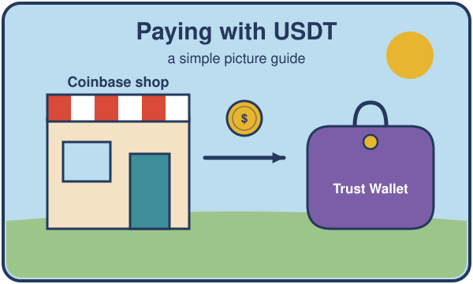

This is a book about money that lives on a phone.

You will buy some coins in a shop called **Coinbase**. You will move them to your own purse, called **Trust Wallet**. Then you will pay someone with a coin called **USDT**.

It is not hard. But it must be done slowly and carefully.

---

## 2. This book is not advice

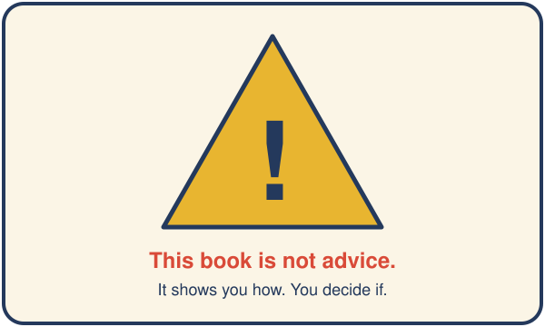

This book shows you *how* to do it. It does not tell you *whether* to do it.

That is your choice. Only make it if you are sure.

---

## 3. Once it goes, it is gone

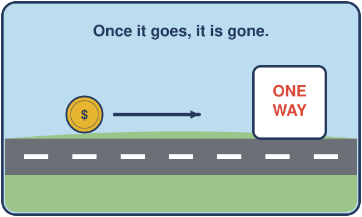

When you send a coin, it cannot come back. There is no "undo" button. No bank can fetch it back for you.

If it goes to the wrong place, it is lost for ever.

Some coins also go up and down in value every day. You could lose some or all of your money.

---

## 4. Say no to strangers

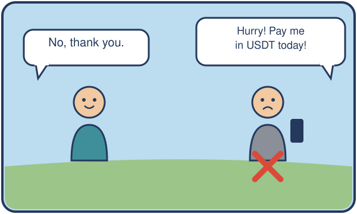

Some people tell lies to get your coins. They might say they are from a bank, a shop, or a company with a job for you. They might say they are your friend.

They often say **"Hurry!"** and **"Pay me in USDT!"**

If someone rushes you, or tells you to keep it secret, say **"No, thank you."** Then talk to someone you trust.

---

## 5. Your twelve secret words

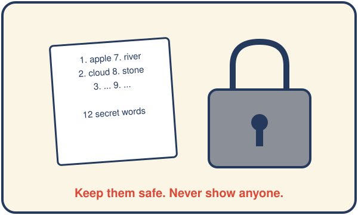

When you make your purse, it gives you twelve secret words. Write them on paper. Keep the paper somewhere safe.

The twelve words **are** your purse. Anyone who sees them can take everything.

Never type them into a website. Never tell anyone. Not even someone who says they are from Coinbase or Trust Wallet.

---

## 6. The shop and the purse

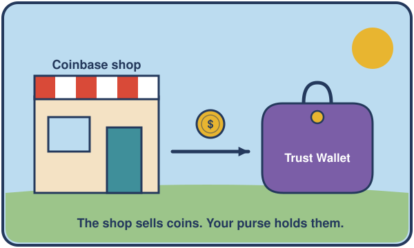

**Coinbase** is the shop. You use your local money there (Sterling, or your local currency) to buy coins.

**Trust Wallet** is your purse. It holds your coins, and only you have the key.

The coins travel from the shop to the purse.

---

## 7. Coins travel on roads

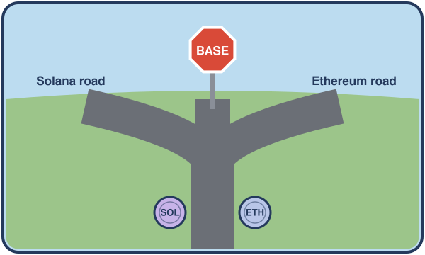

Every coin travels on a road. The roads are called **networks**.

SOL travels on the **Solana** road. ETH travels on the **Ethereum** road.

There is also a road called **Base**. The Coinbase shop likes Base very much and may offer it first. **We do not use Base. Not ever.**

If a coin goes on the wrong road, it can be lost.

---

## 8. Three journeys

You will make three journeys, one after another:

1. **Journey 1:** a little SOL, from the shop to your purse. This is practice.
2. **Journey 2:** a little ETH, from the shop to your purse. More practice.
3. **Journey 3:** USDT, to the person you are paying. This is the real one.

After each journey you **stop and wait** until it has arrived.

---

## 9. Buying the practice coins

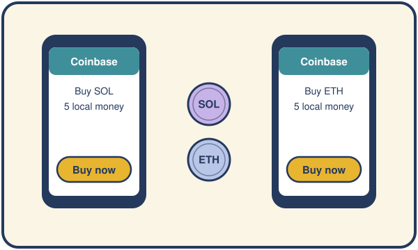

In the Coinbase shop, tap **Buy**. Choose **Solana (SOL)**. Buy 5 in Sterling (or your local currency).

Do it again for **Ethereum (ETH)**.

Now you have two small coins, worth about $5 each.

---

## 10. Journey 1: copy your address

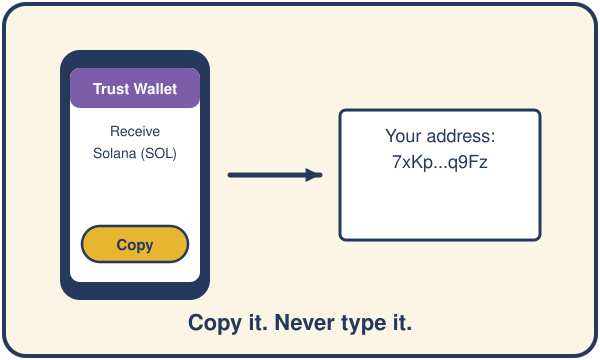

Every purse has an **address**. It is a long line of letters and numbers.

Open Trust Wallet. Tap **Receive**. Choose **Solana (SOL)**. Tap **Copy**.

Never type an address by hand. One wrong letter and the coin is lost.

---

## 11. First four, last four

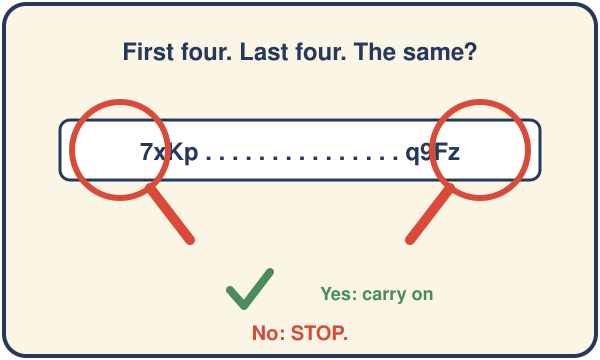

When you paste the address, look at the **first four** letters and the **last four** letters.

Are they the same as in your purse? Good. Carry on.

If they are different, **STOP**. Something is wrong.

Do this every time you paste an address. Every single time.

---

## 12. Send it

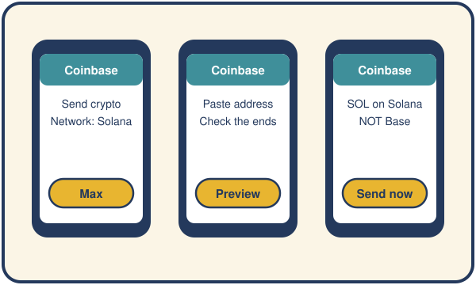

In the Coinbase shop, tap **Transfer**, then **Send crypto**. Choose **SOL**.

Choose the **Solana** road. **Not Base.**

Paste your address. Check the first four and last four. Tap **Max**, then **Preview**. Check it all again. Then tap **Send now**.

---

## 13. Stop and wait

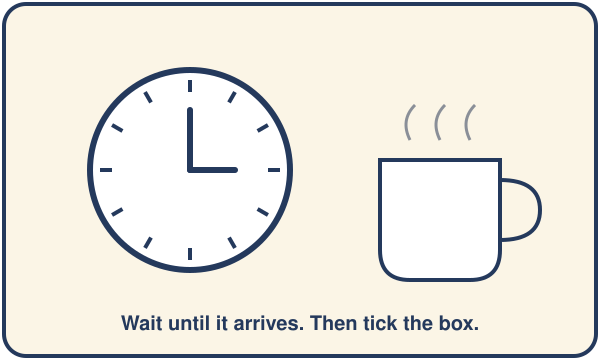

Now stop. Make a cup of tea.

Open your purse and look at **Solana**. When the SOL has arrived, Journey 1 is finished.

Do not start the next journey until it has arrived. If it takes more than an hour, read the Troubleshooting part of the README.

---

## 14. Journey 2: ETH

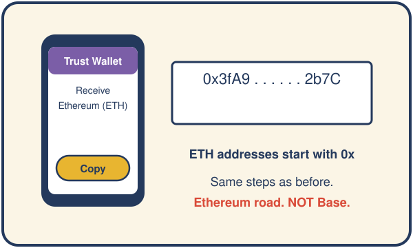

Journey 2 is the same as Journey 1, but with ETH.

ETH addresses start with **0x**.

In the shop, choose the **Ethereum** road. **Not Base**, even if it says it is free.

Then stop and wait again, until the ETH has arrived in your purse.

---

## 15. Fuel for the journey

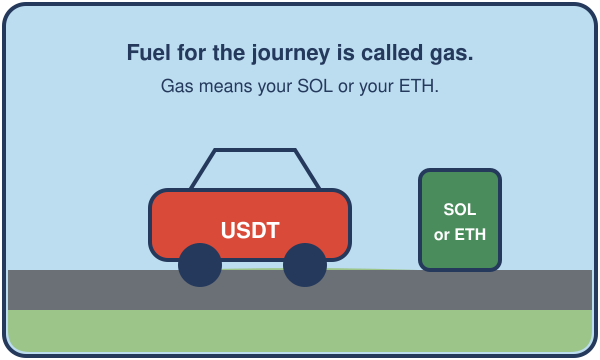

A car needs fuel to travel. A coin needs fuel too. The fuel is called **gas**.

When someone says **gas**, they mean your **SOL** or your **ETH**. That is why you bought them.

USDT on the Solana road uses SOL as fuel. USDT on the Ethereum road uses ETH as fuel.

If your fuel runs out, buy a little more SOL or ETH in the shop. Send it to your purse the same way as before.

---

## 16. Journey 3: ask two questions

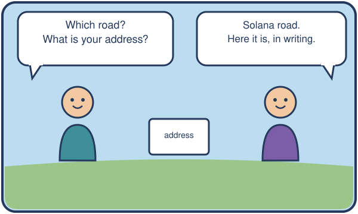

Now for the real journey. First, ask the person you are paying two questions:

1. **"Which road do you want the USDT on?"**
2. **"What is your address on that road?"**

Ask them to write the address down for you as text, not as a picture.

---

## 17. Does it match?

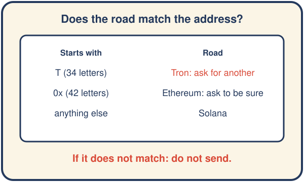

You can often tell the road from the address:

- Starts with **T** and has 34 letters: the **Tron** road. We do not use Tron. Ask for a different road.
- Starts with **0x**: probably the **Ethereum** road. Ask them to say so.
- Anything else: probably the **Solana** road.

Does the road they named match the address? If it does not match, **do not send.** Ask again. If they get cross or say "just send it", walk away.

---

## 18. A little bit first

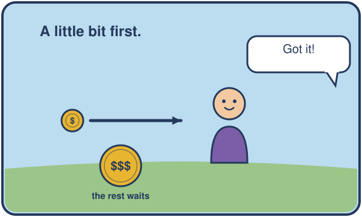

Buy your USDT in the Coinbase shop. Send it to your purse on the right road. **Not Base.** Wait until it arrives.

Then, from your purse, send the person **a little bit first**. About $5 or $10.

Wait for them to say **"Got it!"**

Only then send the rest.

---

## 19. Wrong road?

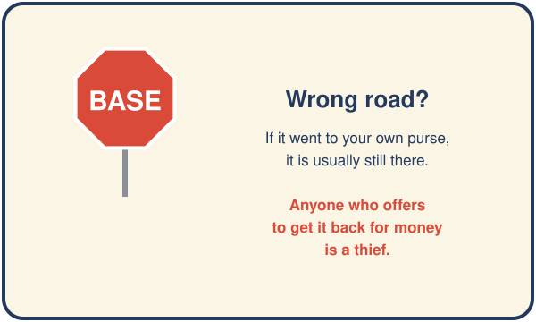

If a coin went on the Base road to your own purse, do not panic. It is usually still there. The README explains how to bring it back.

If someone you do not know offers to get your coins back for a fee, **they are a thief.** Real helpers never message you first.

---

## 20. The rules

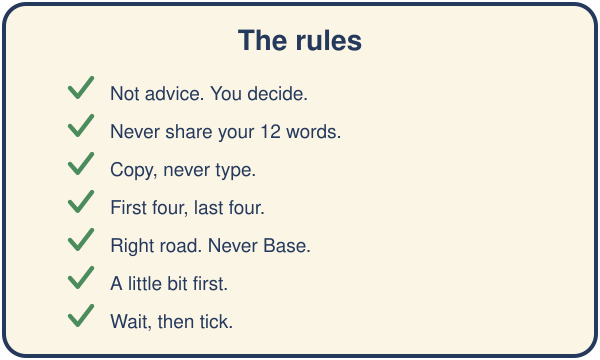

- This is not advice. You decide.
- Never share your twelve secret words.
- Copy addresses. Never type them.
- Check the first four and the last four.
- Choose the right road. Never Base.
- Send a little bit first.
- Stop and wait after every journey.

**The End.**

> [!CAUTION]
> **This guide is not financial, legal or tax advice. It is a how-to for people who have already decided, with their eyes open, to make these transfers.**
